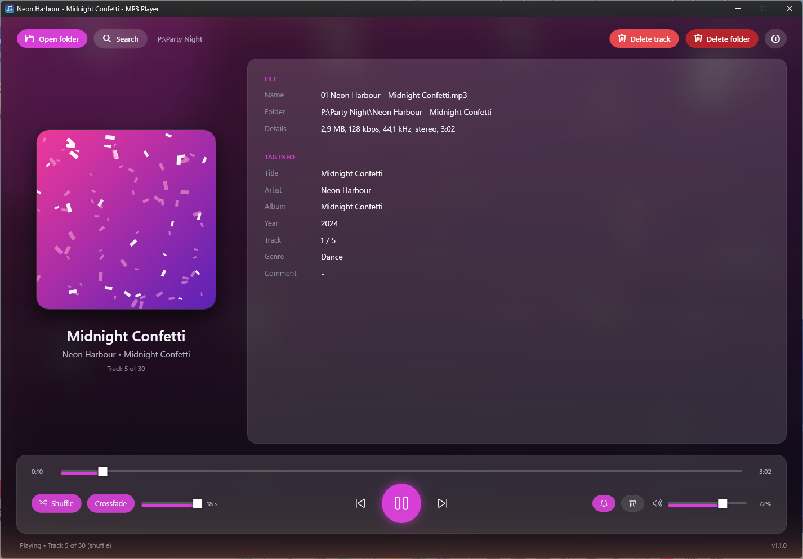

# MP3 Player

[](https://github.com/kreaton/Mp3Player/releases/latest)
[](LICENSE)




**A music player for Windows that plays every MP3 in a folder and all its subfolders.**

There's no library to build: open a folder and listen. If a track or album turns out not to be worth keeping, you can clean it up while it plays.

## Install

**[Download the installer](https://github.com/kreaton/Mp3Player/releases/latest/download/Mp3Player-win-Setup.exe)** and run it. If your PC doesn't have the .NET 10 Desktop Runtime yet, the installer adds it.

The installer isn't code-signed, so Windows may warn you about it. To continue, choose **More info → Run anyway**.

To get a newer version later, click the ⓘ button and choose **Check for updates**. To remove the app, use **Settings → Apps → Installed apps** in Windows.

## What it does

- **Plays whole folders:** pick a folder and every MP3 under it goes into the playlist.
- **Shuffle:** every track plays once in random order before any track repeats.
- **Crossfade:** blends the end of one track into the start of the next, over 1 to 18 seconds.
- **Search:** type part of an artist, album or song title to find a track and play it.
- **Track details:** shows the title, artist, album and cover art, and the window takes its accent color from the cover.
- **Clean-up while you listen:** delete the current track, or the whole folder it's in (usually an album). Both ask first and send the files to the Recycle Bin. You can't delete the folder for tracks that sit directly in the folder you opened. To delete tracks without being asked, turn on the trash-can toggle at the bottom right; deleting a folder always asks.
- **Taskbar controls:** hover over the taskbar icon for delete, previous, play/pause and next buttons.
- **Windows media controls:** the player shows up in the Windows media overlay, Quick Settings and the lock screen, with the track, cover art and a progress bar. The keyboard's media keys work even when the player is in the background.
- **Now-playing notification:** turn on the bell at the bottom right to get a silent notification when a new track starts while the player is in the background.
- **Remembers your settings:** your last folder, volume, shuffle, crossfade and the toggles are still there next time.


## Keyboard shortcuts

| Key | Action |
|---|---|
| Space | Play / pause |
| Ctrl+Right | Next track |
| Ctrl+Left | Previous track, or back to the start if the track has played for more than 3 seconds |
| Right / Left | Forward / back 5 seconds |
| Up / Down | Volume up / down 5% |
| S | Shuffle on / off |
| Ctrl+F | Search |
| F1 | This list of shortcuts, inside the app |
| Media keys (⏯ ⏮ ⏭ on the keyboard) | Play/pause, previous and next, even when the player is in the background. Only if your keyboard has them; on some keyboards they need Fn. |
| Win+A | No media keys? Windows Quick Settings shows the player's play/pause, previous and next, from any app |

Space always means play/pause, even right after you've clicked a button. To press a focused button from the keyboard, use Enter.

## Searching

Type to narrow the list. Up and Down select a track, Enter plays it and Esc closes the window. You can also double-click a track.

Words can be in any order and accents are ignored, so `tears bonnie` finds "Save Up All Your Tears" by Bonnie Tyler.

---

## For developers

| Project | Description |
|---|---|
| `Mp3Player.Core` | The UI-independent player: audio engine with crossfading, playlist and shuffle, tag reading and settings. See its [API reference](Mp3Player.Core/README.md). |
| `Mp3Player.Wpf` | WPF front end with the Fluent theme (`Mp3PlayerWpf.exe`). |
| `promo-video` | Promo videos made with Remotion. See its [README](promo-video/README.md). |

The player uses [NAudio](https://github.com/naudio/NAudio) 2.2.1 for decoding and playback, and [TagLibSharp](https://github.com/mono/taglib-sharp) 2.3.0 for ID3 tags and cover art. Settings are saved to `%AppData%\Mp3Player\settings.json`.

### Build and run

You need the [.NET 10 SDK](https://dotnet.microsoft.com/download). You can also open `Mp3Player.slnx` in a Visual Studio version that supports .NET 10, with `Mp3Player.Wpf` as the startup project.

```bash
dotnet build Mp3Player.slnx
```

```bash
dotnet run --project Mp3Player.Wpf
```

The app takes an optional folder path. When it's given, that folder opens and playback starts right away:

```bash
dotnet run --project Mp3Player.Wpf -- "D:\Music\Some Album"
```

### Releases

Every push to `main` builds the app on GitHub Actions and publishes a new release, one patch version higher than the last (`.github/workflows/release.yml`). To push without releasing, add `[skip ci]` to the commit message. You can also start a release by hand from the repository's Actions tab.

The repository must stay public, because **Check for updates** reads its releases without logging in.
